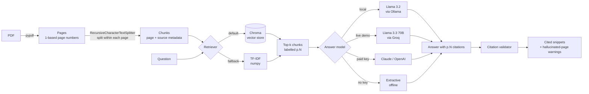

# 📄 PDF Q&A with Page Citations

Ask questions about any PDF and get answers that **cite the page each fact came from**. The app also **flags citations the model invents**, so you can see when an answer isn't grounded.

Built with **LangChain**, **Chroma** and **Streamlit**. Answers come from **Llama 3 via Ollama** on your own machine (free), **Groq** in the live demo (free tier), or Claude/OpenAI if you have a key. It also runs fully offline, so tests and CI never depend on a paid service.

### 🔗 Live demo: https://<app-name>.streamlit.app


---

## The problem

Plain chat-with-PDF demos give fluent answers you can't check. In real use (policies, contracts, research papers) people need to know *where* an answer came from. This project makes every answer traceable to a page and catches citations that point to pages the model never saw.

## How it works



Design choices:

| Decision | Why |
|---|---|
| Chunks never span two pages | Every chunk maps to exactly one page, so a citation is never ambiguous. |
| Context excerpts are labelled `[p.N]` in the prompt | The model copies the page label it sees rather than guessing. |
| Citations are parsed and checked against retrieved pages | Catches made-up citations like `[p.42]`; `Answer.is_grounded` is false when that happens. |
| Pluggable retriever and model | Chroma + real embeddings in production; TF-IDF + extractive answers offline and in CI. |
| Temperature 0, strict "not found" reply | Fewer confident answers that aren't in the document. |

## Tech stack

- **Python 3.10+**
- **LangChain** (`langchain-core`, `langchain-text-splitters`, `langchain-chroma`, `langchain-anthropic`, `langchain-openai`)
- **Chroma** vector store with cosine similarity
- **OpenAI `text-embedding-3-small`** embeddings when `OPENAI_API_KEY` is set; deterministic hashing embeddings otherwise
- **Ollama** (`llama3.2`) locally and **Groq** (`llama-3.3-70b-versatile`) in the live demo, both free; **Claude** or **OpenAI** optional
- **pypdf** for text extraction, **Streamlit** for the UI, **pytest** + **GitHub Actions** for CI

## Project structure

```
├── app.py                     # Streamlit chat UI
├── src/pdfqa/
│   ├── loader.py              # PDF -> pages (1-based page numbers, text cleanup)
│   ├── chunking.py            # pages -> chunks that keep their page number
│   ├── retrieval.py           # Chroma retriever, TF-IDF fallback, offline embeddings
│   ├── llm.py                 # Claude/OpenAI chat models + offline extractive model
│   ├── citations.py           # prompt, citation parsing and validation
│   ├── pipeline.py            # PDFQA: ties it all together
│   └── cli.py                 # command-line interface
├── scripts/make_sample_pdf.py # builds the sample handbook PDF
├── data/sample/               # sample PDF (fictional company handbook)
└── tests/                     # unit tests + a small gold-set evaluation
```

## Run it

```bash
git clone https://github.com/<shreneel>/day-01-pdf-qa-citations.git
cd day-01-pdf-qa-citations
py -3.12 -m venv .venv; .venv\Scripts\Activate.ps1  # Windows PowerShell
# python3 -m venv .venv && source .venv/bin/activate   # macOS / Linux
pip install -r requirements.txt
cp .env.example .env        # Windows: copy .env.example .env  (optional)
```

**Web app**

```bash
streamlit run app.py
```

Upload a PDF, or use the bundled sample. Each answer shows expandable snippets for the pages it cites. The sidebar shows which model is answering.

### Run locally with Ollama (free)

1. Install Ollama from [ollama.com](https://ollama.com).
2. Pull the model once: `ollama pull llama3.2`
3. Run `streamlit run app.py`. With no API keys set, the app finds the running Ollama server automatically. To force it, set `LLM_PROVIDER=ollama` in `.env`.

## Deploy your own (free)

The live demo runs on Streamlit Community Cloud. A hosted app can't reach a model running on my own computer, so the demo uses **Groq**, which serves the same family of open Llama models for free (no credit card). Answers are comparable to the local Ollama version.

1. Get a free API key at [console.groq.com](https://console.groq.com/keys).
2. Push this repo to GitHub (it must be public for the free plan).
3. Sign in at [share.streamlit.io](https://share.streamlit.io) with GitHub → **Create app** → pick this repo, branch `main`, file `app.py`.
4. Under **Advanced settings → Secrets**, paste the contents of `.streamlit/secrets.toml.example` with your real key.
5. Click **Deploy**. Put the resulting `https://<app-name>.streamlit.app` link at the top of this README.

Each visitor gets 20 questions per session (`MAX_QUESTIONS_PER_SESSION`) so a public demo can't exhaust the free quota.

**Command line**

Windows (PowerShell):

```powershell
$env:PYTHONPATH="src"
python -m pdfqa.cli data/sample/northwind_handbook.pdf "Can I fly premium economy on a 7 hour flight?"
```

macOS / Linux:

```bash
PYTHONPATH=src python -m pdfqa.cli data/sample/northwind_handbook.pdf "Can I fly premium economy on a 7 hour flight?"
```

```
Indexed 6 pages / 6 chunks · retriever=tfidf · model=extractive (offline)

Premium economy is allowed for flights of 6 hours or longer. [p.4] Economy class is required for flights under 6 hours. [p.4]
  · p.4: Expenses and Travel Business expenses must be submitted in the expense tool within 30 days…
```

**Use it from Python**

```python
from pdfqa import PDFQA

qa = PDFQA.from_pdf("data/sample/northwind_handbook.pdf")
answer = qa.ask("What is the home office stipend?")
print(answer.text)                         # "... a one-time home office stipend of $750 ... [p.3]"
print([c.page for c in answer.citations])  # [3]
print(answer.is_grounded)                  # True
```

**Tests**

```bash
pytest -v
```

## Results

A small gold set in `tests/test_pipeline.py`: 6 questions, each with a known answer page.

| Setup | Retrieval hit rate @3 | Answer contains fact | Cites correct page |
|---|---|---|---|
| TF-IDF + extractive (offline) | 6/6 | 6/6 | 6/6 |
| Chroma + Llama 3.2 (Ollama, local) | _add your run_ | _add your run_ | _add your run_ |
| Chroma + Llama 3.3 70B (Groq) | _add your run_ | _add your run_ | _add your run_ |

Screenshots:

| Chat with citations | Hallucinated-citation warning |
|---|---|
| _screenshot: docs/chat.png_ | _screenshot: docs/warning.png_ |

## What I learned

- **Citations need to be designed into the pipeline.** Splitting within page boundaries and labelling each context block with its page made citations reliable. Asking the model to "cite sources" without that context was not enough.
- **Validate model output, don't trust it.** A short regex plus a set check catches citations to pages the model was never shown.
- **An offline path makes the project testable.** The TF-IDF retriever and extractive answerer let CI run end to end in under a second, with no API key and no cost.

## Next steps

- [ ] Multi-PDF support with `[file, p.N]` citations
- [ ] Hybrid retrieval (BM25 + vectors) with a cross-encoder reranker
- [ ] Compare local vs hosted models on a bigger eval set (see Day 23)
- [ ] Highlight the cited sentence on a rendered page image
- [ ] OCR fallback for scanned PDFs (`ocrmypdf`)
- [ ] Larger eval set measuring faithfulness and citation precision (see Day 3)

## License

MIT
